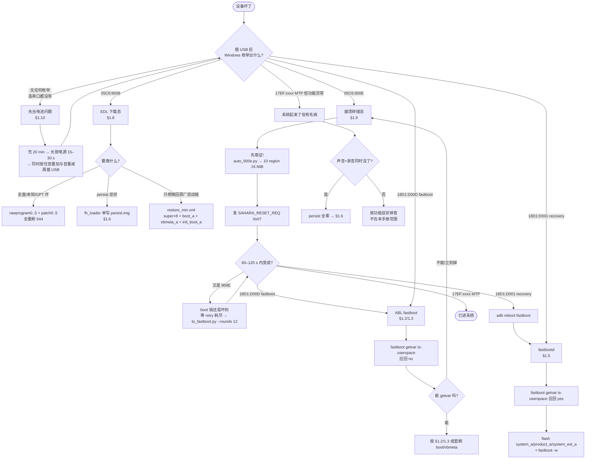

# TB331FC 恢复能力矩阵 · 救砖手册

- 生成日期：**2026-11-24**
- 对象：联想小新 Pad 2024 **TB331FC / khaje / SM6225-AD（骁龙 685）**，A/B（slot-count=2）+ 独立 recovery，UFS 6 个 LUN
- 性质：**只读调研**。未刷机、未写分区、未 reboot、未进 9008。设备侧读取全部走 `adb shell su -c 'dd … | base64'`（不落临时文件）。
- 证据等级：**【实测】**本机真机回显 · **【静态】**对原厂包 XML / firehose / ABL 二进制的静态分析 · **【文档】**来自 `E:\rom` 既有记录（已注明出处）· **【推断】**推理未闭合

> ⚠️ 本次设备侧实测分两轮完成：第一轮 13:1x，USB 中途自行掉线（本机已知的不稳定）；第二轮 13:3x 设备回来，用分块 + 重试的方式补齐了 `fsg`/`modemst`/`oemowninfo` 全量、`misc` 全量、`vbmeta` 现状、`super` 逻辑分区与功能态判据。§3 已按「全部已读」重写，§5 只剩真正未闭合的推断项。

---

## 0. 一句话结论

**这台机器有一张几乎完整的底牌网**：原厂 9008 整包齐全（含 GPT + patch + firehose + QFIL）、解锁位分区完好、persist 功能正常（挂载 + 传感器注册表都在）、A17 六张镜像有 dump 备份、NV 数据在 `modemst1/2` 里（各 74.68% 非零）、本次还把 `oemowninfo`/`modemst`/`fsg`/`fsc`/`devinfo`/`misc`/`vbmeta` 全部只读备份到了 `work\rescue-matrix\reads\`。

**唯一的真·死角是 `xbl` 与 `abl`**——它们既被 fastboot 白名单挡住（只能 9008 写），又是 9008 自己的入口，写坏之后没有任何软件通道。

**两个必须知道的坏消息**：
1. `fsg`（NV「金备份」）**整块全零**、`fsc` 也全零 ⇒ 本机从未做过 NV backup。`modemst1/2` 一旦被擦，**没有金备份可回滚**（对 WiFi-only 影响小，但是单向损失）。
2. 官方 9008 整包**不写** 41 个分区（含 `persist`/`oemowninfo`/`devinfo`/`fsg`/`fsc`/`modemst`/`frp`/`uefivarstore`），且 `super` **只覆盖前 6.79 GiB**（尾部 5.21 GiB 不擦）⇒ 坏在这些地方的症状，刷官方包**永远修不好**。

### 最危险的三个操作

| # | 操作 | 为什么最危险 |
|---|---|---|
| 1 | 跑 `image\provision_*.xml`（UFS provisioning）或 QFIL 勾「全部格式化」、跑 `erase_UFS-128G.xml` | 这是**重新划分 UFS 物理 LUN**（`bLUEnable`/`size_in_kb`/`bLUWriteProtect`/`bBootEnable`）的一次性工厂操作。参数错 = LUN 几何与 GPT 全部对不上，**连 rawprogram 都再也写不进去**。文件头自己写着 `WARNING: PROVISIONING UFS IS A ONE TIME OPERATION IN FACTORY`。 |
| 2 | `fastboot flashing lock`（回锁） | 本机 ABL **只注册了 `oem unlock`**，没有 `flashing unlock`（【静态】命令表 27 条，见 §2.4）。回锁后**没有合法通道再解开**，只能靠 Lenovo 签发令牌 + 已锁态下大概率拒刷 → 直接变砖。 |
| 3 | 9008 写 `abl` / `xbl`（或任何 critical 分区） | fastboot 层对 24 个 critical 分区硬拦（与锁定状态无关），**9008 层没有任何保护**。`abl` 写坏 = 失去 fastboot（只剩 9008）；`xbl` 写坏 = 9008 也不一定能起，**软件侧无解**。 |

> 附加高危：`fastboot oem oemowninfo set <field>,<value>` —— 【静态】唯一**不受锁定/critical 白名单保护**的持久写入口（handler 只校验字段名与长度）。改 `sn`/`btmac`/`wifimac` = 改出厂身份。本机此前**没有任何 `oemowninfo` 备份**，本次已补了一份当前值的完整备份（§3.5），但「写坏之后能不能原样写回」尚未验证。

---

## 1. 状态 → 手段矩阵

每一行回答四件事：**怎么认出来 → 能不能救 → 用什么命令 → 代价与成功率**。

统一前置：`adb`=`E:\rom\tools\platform-tools\adb.exe`；fastboot 同目录；9008 工具=`E:\rom\TB331FC\刷机包\TB331FC_ZUI_16.0.544\tool\`（`fh_loader.exe` / `QSaharaServer.exe`）或 `E:\rom\work\edl\`。

### 1.1 总表

| # | 坏法 | 现象（USB ID / 屏幕） | 首选手段 | 成功率 | 代价 |
|---|---|---|---|---|---|
| A | 只刷坏 `boot` | 屏亮 logo 后黑/重启；USB 有时枚举 `18D1:D00D`(fastboot) | `fastboot flash boot_a` 回原厂 | **≈100%** | 1 次刷写 |
| B | `vbmeta` 改坏 | 停在 `18D1:D00D`，`fastboot reboot` 无效，进不了 fastbootd | 回原厂 `vbmeta`+`vbmeta_system`；不行则 9008 | **90%** fastboot / **100%** 9008 | 可能丢 fastbootd 会话 |
| C | `init_boot`/`vendor_boot` 不配套 | **~10–35 s 后 USB 整体消失 → `05C6:900E`** | 先退出 900E（§1.9），再成套回刷 | **85%** | 每轮烧 1 次 slot-retry |
| D | super / 逻辑分区损坏 | 卡第二屏、`Failed to mount /system`、或同样 900E | fastbootd 单刷三块 / 9008 刷 super 八片 | **≈100%** | **丢 `/data`**（若 `-w`） |
| E | `persist` 全零 | 能开机，但**声音+录音同时没了**、BT MAC=null、传感器注册表 ENOENT | 9008 + `fh_loader` 单写 `persist.img` | **100%**（已实战） | 32 MB 写；MAC 变通用值 |
| F | GPT / 分区表被动过 | `partition-size:*` 报错、fastboot 认不出分区、9008 也找不到 label | 9008 跑 `rawprogram0..5` + `patch0..5`（重写 GPT） | **95%** | 全盘重来；**唯一会动 GPT 的常规操作** |
| G | 完全黑砖（只有 9008） | 屏全黑、无 logo；USB 只有 `05C6:9008` | 9008 全量刷 544 | **90%** | 清 `/data`；`persist` 等不写（见 §2.3） |
| H | 900E 崩溃态 | USB `05C6:900E`（`Qualcomm HS-USB Diagnostics 900E`），adb/fastboot 全无 | RESET_REQ 退出 → 抢 fastboot → 修 boot 链 | **70%**（取决于能否抢到 fastboot 窗口） | 每发一次 RESET 烧 1 次 retry |
| I | 电池耗尽 / 无法开机 | 插电无反应、或只闪充电图标 | 充 20 min → 15–30 s 长按电源 → 音量+ + 音量− 插 USB 进 9008 | **95%** | 时间 |

### 1.2 A · 只刷坏 `boot`（Android 起不来，但 bootloader 能进）

**判据**
- `fastboot devices` 能看到设备，且 `fastboot getvar is-userspace` → **`no`**（= ABL，不是 fastbootd）。
- 屏幕停在 logo / 黑屏但 USB 枚举 `18D1:D00D`。
- 【静态】ABL 的 `continue`/正常启动路径 = `LoadKernel`(0x1afd4) → `BootLinux`(0x6a30)；`LoadKernel` 失败会打印 `Failed to load image from partition: %r` 并**留在 fastboot**——这就是「boot 坏但 bootloader 活」的机制来源。

**手段**（任选，A 槽）
```bat
fastboot getvar is-userspace          :: 期望 no
fastboot getvar current-slot          :: 期望 a
fastboot flash boot_a  E:\rom\extracted\GSI_Kit\05_镜像\boot_a_原始.img
fastboot flash vbmeta_a E:\rom\TB331FC\刷机包\TB331FC_ZUI_16.0.544\image\vbmeta.img
fastboot reboot
```
**为什么连带刷 vbmeta**：本机 ABL 会用 `vbmeta_system` 的 hashtree 描述符判「slot 可不可启动」（【文档】`work\docs\STATE.md` 10-25 18:26 条）。只换 boot 而 vbmeta 里没有对应 hash 描述符，可能被判不可启动 → 停 `18D1:D00D`，白忙一次。

**成功率**：≈100%。**代价**：1 次刷写，`/data` 不动。
**回退**：`fastboot flash boot_a` 换回 A17 的 `E:\rom\work\a17dump\boot_a.img`（sha256 `2510b098…`）。

### 1.3 B · `vbmeta` 被改坏（AVB 不过）

**先纠正一个流传的误解**（两份报告口径不同，这里是调和后的版本）：

| 层 | 行为 | 证据 |
|---|---|---|
| **签名校验** | 解锁态 **跳过**。`AvbSlotVerify` 失败后走 `Device is unlocked, Skipping boot verification`（串 `@0xaaa52`，引用点 `0x1baa4`），继续启动 | 【静态】`work\woa\abl-cmd-surface\REPORT.md` §3.3 |
| **hashtree 描述符一致性** | **不跳过**。描述符里的 root digest 与分区实际数据不一致 → 判 slot 不可启动 → 停 `18D1:D00D`，连 fastbootd 都不放行 | 【文档】`STATE.md` 10-25 18:26；【实测】10-27 多次 |
| **内核侧 dm-verity** | ABL 放行后，内核挂载时 verity 失败 → `dm-13: data block 0 is corrupted` → init 挂不上 → `Attempted to kill init!` → panic → **900E** | 【实测】2026-11-13 `work\tools\verify_hashtree.py` 复算，product_D 自洽性失败 |

⇒ 所以「vbmeta 坏」会落进**两个不同终点**：描述符整体不可信 → `18D1:D00D`；描述符可信但内容不符 → 900E。

**判据**
- 停 `18D1:D00D` 且 `fastboot reboot` / `fastboot reboot fastboot` 都回不来 → 走本行。
- `fastboot getvar veritymode` 若可读，`eio` = 解锁态允许继续（本机常态）。

**手段**
```bat
:: 1) 先只回 vbmeta 对（最小改动）
fastboot flash vbmeta_a        E:\rom\TB331FC\刷机包\TB331FC_ZUI_16.0.544\image\vbmeta.img        :: 8192 B
fastboot flash vbmeta_system_a E:\rom\TB331FC\刷机包\TB331FC_ZUI_16.0.544\image\vbmeta_system.img :: 4096 B
fastboot reboot

:: 2) 若仍停 18D1:D00D → 说明不是 vbmeta 单独的问题，成套回刷（见 1.4 / 1.7）
```
**成功率**：fastboot 层 90%（本机实测过「换回原厂 vbmeta 仍不进 fastbootd」，那时是三块 system 已被换成 A17 内容，属于 C/D 类）；9008 全量 100%。
**代价**：无数据损失（除非走 9008 全量）。
**红线**：不要再刷「自签 testkey + `flags=2`」的 vbmeta —— 【文档】已实测 ABL 不放行（`work\work\a17stage\vbmeta_a_tk_flags2.img`），且会把 fastbootd 一起弄丢。

### 1.4 C · `init_boot` / `vendor_boot` 不配套（已知症状：init 退出 127 → panic → 900E）

**判据（这条最有辨识度）**
- 开机后 **约 10–35 s**（实测样本：10 s / 20 s / 25 s / 31 s / 33 s / ≤342 s 各一次），屏幕还在 logo，**USB 整体消失**，随后以 `05C6:900E` 出现。
- **不是**停在 `18D1:D00D`（那是 ABL 拒绝启动，见 1.3）；**不是** `18D1:D001`。
- 【实测】崩前一刻 `fastboot getvar is-userspace` 仍是 `yes`（在 fastbootd）——「崩前可达、崩后不可达」。
- 根因机制（已闭合的那一支）：`product`/`system` 的 dm-verity 校验失败 → init 读不到 superblock → `Attempted to kill init!` → panic → Qualcomm crash dump → 900E。
  `init` 退出码 127 = 找不到可执行的 init/被 exec 拒绝，是同一族症状的另一种表现。

**手段（顺序不能反）**
```
① 退出 900E → 抢 fastboot            python E:\rom\work\tools\to_fastboot.py --rounds 12
② 成套回刷（boot 链必须同源！）
   fastboot flash boot_a        ...\image\boot.img
   fastboot flash init_boot_a   ...\image\init_boot.img
   fastboot flash vendor_boot_a ...\image\vendor_boot.img
   fastboot flash dtbo_a        ...\image\dtbo.img
   fastboot flash vbmeta_a      ...\image\vbmeta.img
③ 逻辑分区也回原厂（否则 verity 还是对不上）
   fastboot reboot fastboot
   fastboot flash system_a     ...\image\super_4.img
   fastboot flash product_a    ...\image\super_3.img
   fastboot flash system_ext_a ...\image\super_6.img
④ fastboot -w ; fastboot reboot
```
**成功率**：85%（失败的多是「只换了 boot 没换 vbmeta_system」或「三块逻辑分区没回原厂」）。
**代价**：`-w` 清 `/data`。
**铁律**：boot / init_boot / vendor_boot / dtbo / vbmeta / system 三件套 **必须来自同一发布套件**；混搭 = 900E（本机已反复验证）。

### 1.5 D · super / 逻辑分区损坏（system/product/vendor 挂载失败）

**判据**
- 能过 ABL、能进内核，但卡第二屏/开机动画无限循环。
- `adb logcat`（若能进 recovery adb）或 pstore 里见 `Failed to mount /system`、`dm-N: data block ... is corrupted`、`fs_mgr: Failed to open block device`。
- 或直接落 900E（同 1.4 的机制，但触发点在 system 侧）。

**手段 1（推荐，快）：fastbootd 单刷三块**
```bat
adb reboot fastboot                      :: 或 fastboot reboot fastboot
fastboot getvar is-userspace             :: 期望 yes（= fastbootd）
fastboot flash system_a     E:\rom\TB331FC\刷机包\TB331FC_ZUI_16.0.544\image\super_4.img
fastboot flash product_a    E:\rom\TB331FC\刷机包\TB331FC_ZUI_16.0.544\image\super_3.img
fastboot flash system_ext_a E:\rom\TB331FC\刷机包\TB331FC_ZUI_16.0.544\image\super_6.img
fastboot -w
fastboot reboot
```
【文档】已验证两次；`super_4.img`=system_a、`super_3.img`=product_a、`super_6.img`=system_ext_a。

**手段 2（彻底）：9008 刷 super 八片**——见 §2.3；注意**只覆盖 super 前 6.79 GiB**，尾部 5.21 GiB 不擦（§2.5）。

**成功率**：≈100%（若 super 的**逻辑分区元数据（LP metadata）**本身坏了，单刷数据片不够，必须走 9008 让 `super_1/2` 把 LP 元数据一起写回）。
**代价**：`-w` 丢 `/data`；逻辑分区尺寸若被改过（`resize` 过），要按原尺寸 `delete/create` 再刷。

### 1.6 E · `persist` 全零（历史真因：声音 + 录音同时消失）

**判据（两条可靠 + 一条已推翻）**

| 判据 | 健康值 | persist 全零时 | 可靠度 |
|---|---|---|---|
| `grep persist /proc/mounts` | 有 persist 一行 | 没有 | ★★★ 最硬 |
| `ls /mnt/vendor/persist/sensors/registry/registry` | 存在（含 `ak0991x_0` 等） | ENOENT | ★★★ |
| ~~`settings get global bluetooth_address`~~ | ~~真实 MAC~~ | ~~`null`~~ | ⚠️ **已推翻**：本次实测 persist 正常挂载、`bluetooth_address` 仍是 `null`（§3.5）。**不能单独用来判定** |

**为什么官方刷机永远修不好**：`rawprogram0.xml` 里 persist 那行是 `filename=""` —— **只定义几何，不写内容**。【静态】本次重新核对确认（`analyse_package.py` 输出「只定义几何、不写内容」清单第 2 项就是 persist）。

**手段（只写 32 MB，不动别的分区）**
```bat
:: 工作目录必须纯 ASCII
cd /d E:\rom\work\edl
:: 先回读备份（务必！）
fh_loader.exe --port=\\.\COM4 --sendxml=read_persist.xml --zlpawarehost=1 ^
              --memoryname=ufs --noprompt --verbose
:: 再写
fh_loader.exe --port=\\.\COM4 --sendxml=write_persist.xml --zlpawarehost=1 ^
              --memoryname=ufs --noprompt --verbose --reset
```
两个易错点：【文档】端口必须写 **`\\.\COM4`**（裸 `COM4` 会警告）；读也是 `--sendxml`，XML 里用 `<read>` 元素（没有 `--readxml`）。

**成功率**：100%（2026-11-01 实战，`{SUCCESS}` / 40.97 MBps，用户两次确认间隔 9.5 h）。
**代价**：写的是刷机包里的**通用** persist，MAC 会变成通用值，不是本机出厂 MAC（原值已不可追回）。

### 1.7 F · 分区表 / GPT 被动过

**判据**
- `fastboot getvar partition-size:persist` → `FAILED (remote: 'GetVar Variable Not found')` 或返回错值。
- `fastboot flash <part>` 报 `Invalid partition name`。
- 9008 里 fh_loader 报 `Not a valid GPT signature at sector %d`（firehose 内建字符串）。

**手段：9008 跑全套 `rawprogram0..5` + `patch0..5`**
这是**唯一**能重写 GPT 的常规手段。【静态】rawprogram 里每个 LUN 都有两条 `partofsingleimage="true"` 的条目：
```
label="PrimaryGPT"  start_sector="0"            filename="gpt_mainN.bin"   (6 sectors)
label="BackupGPT"   start_sector="NUM_DISK_SECTORS-5." filename="gpt_backupN.bin" (5 sectors)
```
且 `patchN.xml` 每条 26 项，往 **`DISK` 裸扇区**写：
```
byte_offset=16  ← CRC32(1,92) / CRC32(4,92) / CRC32(NUM_DISK_SECTORS-1.,92)
byte_offset=24  ← NUM_DISK_SECTORS-1.     (backup GPT 的 LastUsableLBA)
byte_offset=32  ← NUM_DISK_SECTORS-1.     (backup GPT 的 AlternateLBA)
byte_offset=48  ← NUM_DISK_SECTORS-6.
byte_offset=72  ← NUM_DISK_SECTORS-5.
byte_offset=88  ← CRC32(0,4096) / CRC32(2,4096) / CRC32(NUM_DISK_SECTORS-5.,4096)
byte_offset=1704(0)/296(1,2)/424(3)/168(4)/680(5) ← NUM_DISK_SECTORS-6.
```
**好消息**：全部用 `NUM_DISK_SECTORS` 变量而不是硬编码，所以会**按真实盘容量自适应**——同一份包可以刷 128G/64G 不同容量的机器。
**坏消息**：正因为是变量，一旦 LUN 指向错（`physical_partition_number` 写错）或盘容量读错，会写出**自洽但错误**的 GPT，之后所有 label 查找都会错位。

**成功率**：95%（GPT 全毁 + 逻辑分区也丢的情况，跑完等于全新机）。
**代价**：全盘重来 + 清 `/data`。

### 1.8 G · 完全黑砖（只有 9008）

**判据**：屏全黑、无 logo、无震动；Windows 只枚举 `05C6:9008`（QDLoader）。`adb`/`fastboot` 全空。

**手段：9008 全量刷 ZUI 16.0.544**
```
1) 进 9008：先充 20 min → 长按电源 15–30 s 关机 → 同时按住 音量+ 与 音量- → 插 USB
   （失败：放余电 1 min 重试；或用 E:\rom\TB331FC\9008 工具箱\WuXingEdl.exe；最后才拆机短接）
2) QFIL：Configuration = ufs | 0 - no validation | Flat Build | Reset After Download
   Programmer = image\prog_firehose_sm6225_ddr.elf
   rawprogram = rawprogram0.xml … rawprogram5.xml（6 个全给）
   patch      = patch0.xml … patch5.xml（6 个全给）
   ⚠️ 绝对不要勾「全部格式化」
3) 或纯命令行（fh_loader，可脚本化）：
   fh_loader.exe --port=\\.\COM4 --sendxml=rawprogram0.xml --memoryname=ufs --noprompt --verbose
   … 0..5 逐个；再 patch0..5 逐个；最后 --reset
```
【文档】踩坑：`fh_loader` **必须** `--memoryname=ufs`（漏掉存储类型是上次失败的真因）；工作目录纯 ASCII；QSaharaServer 常常 `Unable to read packet header` 但此时设备 `BusReportedDeviceDesc` 已是 `QUSB_BULK_CID:043A_SN:…`，**说明 firehose 早已就绪，fh_loader 可直接连**。

**成功率**：90%。**代价**：清 `/data`；`persist`/`misc`/`devinfo`/`oemowninfo`/`fsg`/`fsc`/`modemst*`/`frp`/`uefivarstore`/`keystore`/`lenovo*`/`recovery_b`/`init_boot_b`/`vendor_boot_b`/`cmnlib*` **不会**被写（§2.3），所以坏在那些分区的症状刷完**依然存在**。

### 1.9 H · 900E 崩溃态（RESET_REQ 会回 900E 还是 fastboot？）

这是本手册最需要写清判据的一格，因为历史记录里**两种行为都真实发生过**。

#### 机制（已实测的三条）

| 事实 | 证据 |
|---|---|
| 900E 是 **Sahara 的 `mode=02`（memory dump）** 态，不是 9008 的下载态 | 【实测】48 B Sahara 头 `mode=02`；`fh_loader`/`QSaharaServer` 对 900E **全超时** |
| `SAHARA_RESET_REQ (0x07)` 让它**复位**，不复位就永远停在 900E | 【实测】`reset_9008.py` / `kick_900e.py` |
| 若目标已卡在 `END_TRANSFER` 循环，要先发 `SAHARA_RESET_STATE_MACHINE (0x13)` 让它**重新吐 HELLO_REQ**，才能接 MEMORY_DEBUG | 【实测】`recover_900e.py` 头注释：错 HELLO_RSP 后目标每 ~50 ms 重发 `END_TRANSFER(cmd=0x04,len=0x10,status=0x01)` |

#### 判据表：RESET_REQ 之后落到哪

**决定性因素只有一个：复位后 ABL 重新走一遍启动决策，而 `boot` 分区里现在是什么。**

| 复位后 USB PID | 含义 | 为什么会这样 | 下一步 |
|---|---|---|---|
| 又是 `05C6:900E` | ABL 放行了 slot，内核/init 又崩了一次 | **boot 链里那个会崩的东西还在**（典型：刚刷进去的 A17 三件套 + 不匹配的 vbmeta_system） | 这条路走不通，见下方「三个逃生门」 |
| `18D1:D00D` | **ABL fastboot** | ABL 判定 slot 不可启动（vbmeta 描述符/签名/flags 不对，或 boot 镜像无法解析）→ 停在 fastboot | 立刻 `fastboot getvar is-userspace`（应 `no`）→ 刷 boot/vbmeta |
| `18D1:D001` | recovery（有 adb） | slot-retry 耗尽，ABL 转 recovery | `adb reboot fastboot` → fastbootd |
| `17EF:xxxx` | 已进系统（MTP） | boot 链已修好 | 收工 |

**为什么同一台机两种都出现过**：
- 2026-11-13【文档】`auto_900e.py` 头注释：「RESET_REQ on a 0x900E device does NOT re-crash it; it lands in fastboot (18D1:D00D)」——那次是**已经把 boot 换成不再崩的内容**之后的观测。
- 2026-11-23【实测】`forensics_900e\auto_20261123_233801\auto.log`：`already in 900E; resetting first so we race a FRESH window` → `no fastboot yet` → `still in 900E without fastboot; will try the race directly`——这次 boot 里还是 A17，**复位即复崩**。

⇒ 所以「RESET_REQ 回 fastboot」不是 RESET 的性质，而是**当时 boot 分区内容的性质**。把它当固定行为会误判。

#### 三个逃生门（从 900E 真的出去）

1. **等 retry 耗尽**（最省事，最慢）：反复 `python work\tools\to_fastboot.py --rounds 12`，每次 RESET 让 ABL 尝试启动一次并失败 → `slot-retry-count:a` 递减（历史读到过 `a:7` / `a:6` / `a:5`）→ 耗尽后 ABL 停启动，落 recovery(`18D1:D001`) 或 fastboot。**代价：每轮烧 1 次 retry**（这是 `to_fastboot.py` 的显式假设，未做单变量验证）。
2. **抢窗口**：复位后立刻轮询 USB，若出现 `18D1:D00D` 就 `fastboot flash boot_a <好镜像>`。成功率取决于 ABL 是否肯停在 fastboot。
3. **900E → 9008**（不确定可用，**未验证**）：900E 是 Sahara memory-debug 态，理论上复位时按住音量键可能落 EDL，但本机**没有任何一次从 900E 直接进 9008 的记录**。别把它当计划 A。
4. **物理按键复位**：`RESET_REQ` 不被接受（端口不消失）时，唯一出路是长按电源 15–30 s。

#### 顺手能拿到的取证（免费，建议做）

900E 是**唯一能读到崩溃现场**的窗口：
```bat
python E:\rom\work\tools\auto_900e.py --regions md_KLOGBUF.BIN,md_LOG_INFO.BIN
:: 实测输出：table @0x45ef20b0 len 0x1d00 / 116 regions / 10 region 16.1 MiB 全 OK
```
已取到 5 份（`work\forensics_900e\auto_20261113_114831` 等，最新 `auto_20261123_233801`）。**先取证再救砖**，否则崩溃现场随复位一起消失。

### 1.10 I · 电池耗尽 / 无法开机

**判据**
- 插 USB 完全无枚举（连 `05C6:9008` 都没有），或只闪一下充电图标。
- `fastboot getvar battery-voltage` / `battery-soc-ok`（若能进 fastboot）显示低电。
- 【静态】`getvar` 里 `charger-screen-enabled:1`、`off-mode-charge:1` 是当前设置。

**手段**
```
1) 插原装充电器静置 20 min（【文档】0% 极易掉线，是进 9008 失败的头号原因）
2) 长按电源 15–30 s 强制关机
3) 同时按住 音量+ 与 音量− 再插 USB → 听到「叮」再松手 → 05C6:9008
4) 仍不行：拔线放余电 1 min 重试；或 WuXingEdl.exe；最后才拆机短接
```
**成功率**：95%。**代价**：时间；9008 本身是 USB 供电，电池 0% 也能刷，但**刷完必须能起**，所以别在电池彻底坏的情况下做实验。

**顺带**：若嫌开机自动进充电屏烦，`fastboot oem off-mode-charge 0` / `fastboot oem disable-charger-screen`（都是 W 类，可改回）。

---

## 2. 9008（EDL）能力边界

### 2.1 firehose 能做什么、受不受签名限制

**programmer**：`image\prog_firehose_sm6225_ddr.elf`（670,608 B）与 `prog_firehose_sm6225_lite.elf`（670,480 B）；`QC_IMAGE_VERSION_STRING=BOOT.XF.4.1-00374-KAMORTALAZ-1`。【静态】字符串扫描得到的能力面：

| 能力 | 状态 | 依据 |
|---|---|---|
| `<program>` 写任意 LUN / 任意扇区 | ✅ | 字符串 `program`；`UFS Format whole LUN %s` |
| `<read>` 读任意 LUN / 任意扇区 | ✅ | 字符串 `read`；`Read throughput %uBps` |
| `<erase>` 擦 | ✅ | `Erase Failed sector %d` |
| `<patch>` 改单字节 | ✅ 但**已弃用** | 字符串 `patch command is deprecated` / `patch size too large %d` |
| `<configure>` 设 `MemoryName=ufs` / `MaxPayloadSizeToTargetInBytes` / `ZlpAwareHost` | ✅ | 字符串同名 |
| `<setbootablestoragedrive>` | ✅ | 同名 |
| `<power>` reset / reset_to_edl | ✅ | `reset_to_edl` / `power/reset option not specified, default is do reset %d` |
| `<getstorageinfo>` | ✅ | 同名；返回 `{"storage_info": {...}}` JSON |
| `peek` / `poke`（直接读写内存） | ❌ **secure boot 设备禁用** | `Peek is disabled on secure boot devices%c` / `Poke is disabled on secure boot devices%c` |
| VIP（signed digest table） | ⚠️ 代码支持，**本机未启用** | `VIP is enabled, receiving the signed table of size %d` / `Authentication of signed hash failed %d`；实测 QFIL 走 `0 - no validation` 可正常刷全盘 |

**签名限制的结论**：本机 `fastboot getvar secure` = **`yes`**（【实测】`work\docs\getvar_all.txt`），但 firehose **不要求签名镜像** —— 唯一的签名相关限制是 `peek`/`poke` 被禁，`program`/`read`/`erase` 全部可用。这与【文档】「QFIL 整包用 `0 - no validation` 成功」一致。
**风险提示**：`peek`/`poke` 被禁意味着 **9008 下不能直接改内存绕过任何东西**；也别指望用它们修 `xbl`。

**fh_loader 的命令面**（【静态】`fh_loader.exe` 自报，`work\edl\fh_read_out.txt`）：
```
benchmarkdigestperformance  benchmarkreads  benchmarkwrites  createdigests
chaineddigests=  contentsxml=  convertprogram2read  digestsperfilename=
erase=  files=  firmwarewrite  fixgpt=  flattenbuildto=  flavor=
forcecontentsxmlpaths  getstorageinfo=  json_in=  labels=  loglevel=  lun=
mainoutputdir=  maxpayloadsizeinbytes=  memoryname=  notfiles=  notlabels=  nop
noprompt  num_sectors=  port=  porttracename=  reset  search_path=
sectorsizeinbytes=  sendimage=  sendxml=  setactivepartition=  showpercentagecomplete
signeddigests=  start_sector=  verbose  verify_programming  verify_programming_getsha
zlpawarehost=
```
两个被低估的：
- **`--fixgpt=<分区数> --lun=<n>`**：GPT 坏了但不想全盘重刷时的**定点修复**入口（本手册 §1.7 的轻量替代）。
- **`--setactivepartition=<n>`**：设 UFS 的**活动 boot LUN**，与 Android 的 A/B slot **完全无关**，别混淆。

### 2.2 扇区偏移表（已核对 + 补全）

来源：【静态】`rawprogram0..5.xml` 全量解析（脚本 `work\rescue-matrix\parse_rawprogram.py`，完整 128 行落 `work\rescue-matrix\sector_table.tsv`）。**扇区大小 4096 B**。

| 分区 | LUN | start_sector | 字节偏移 | 扇区数 | 大小 | 用途 |
|---|---|---|---|---|---|---|
| `PrimaryGPT` | 0..5 各 | 0 | `0x0` | 6 | 24 KiB | 主 GPT |
| `BackupGPT` | 0..5 各 | `NUM_DISK_SECTORS-5` | 盘尾 | 5 | 20 KiB | 备份 GPT |
| `persist` | 0 | 8 | `0x8000` | 8192 | 32 MiB | 校准/传感器/真实 MAC |
| `misc` | 0 | 8200 | `0x2008000` | 256 | 1 MiB | BCB / slot 元数据 |
| `keystore` | 0 | 8456 | `0x2108000` | 128 | 512 KiB | keystore |
| `oemowninfo` | 0 | 8584 | `0x2188000` | 256 | 1 MiB | 出厂身份 sn/btmac/wifimac |
| `lenovolock` | 0 | 8840 | `0x2288000` | 128 | 512 KiB | Lenovo 锁标记 |
| `lenovocust` | 0 | 8968 | `0x2308000` | 76800 | 300 MiB | Lenovo 定制区 |
| `lenovoraw` | 0 | 85768 | `0x14F08000` | 4096 | 16 MiB | Lenovo 原始区 |
| `frp` | 0 | 89864 | `0x15F08000` | 128 | 512 KiB | 恢复出厂保护 |
| `super` | 0 | 89992 | `0x15F88000` | 3145728（分区）/1779934（包内写入） | 12 GiB / 写 6.79 GiB | 动态分区容器 |
| **`vbmeta_system_a`** | **0** | **3235720** | **`0x315F88000`** | 16 | 64 KiB | system/product/system_ext 的 vbmeta |
| `vbmeta_system_b` | 0 | 3235736 | `0x315F98000` | 16 | 64 KiB | 同(b) |
| `metadata` | 0 | 3235752 | `0x315FA8000` | 16384（分区）/2594（包内） | 64 MiB | 加密元数据 |
| `userdata` | 0 | 3252136 | `0x319FA8000` | 109.9 GiB（分区）/18199（包内） | 用户数据 |
| `xbl_a` | 1 | 6 | `0x6000` | 896 | 3.5 MiB | **XBL（critical）** |
| `xbl_config_a` | 1 | 902 | `0x386000` | 32 | 128 KiB | XBL 配置 |
| `xbl_b` / `xbl_config_b` | 2 | 6 / 902 | 同上 | 896 / 32 | — | b 槽 |
| `cdt` | 3 | 32 | `0x20000` | 32 | 128 KiB | 平台配置 |
| `ddr` | 3 | 64 | `0x40000` | 256 | 1 MiB | DDR 训练 |
| `rpm_a` | 4 | 6 | `0x6000` | 128 | 512 KiB | RPM |
| `tz_a` | 4 | 134 | `0x86000` | 1024 | 4 MiB | TrustZone |
| `hyp_a` | 4 | 1158 | `0x486000` | 128 | 512 KiB | hypervisor |
| `modem_a` | 4 | 1286 | `0x506000` | 46080 | 180 MiB | modem 固件 |
| `bluetooth_a` | 4 | 47366 | `0x2E46000` | 256 | 1 MiB | BT 固件 |
| `abl_a` | 4 | 56838 | `0xDE06000` | 256 | 1 MiB | **ABL（critical，fastboot 本体）** |
| `dsp_a` | 4 | 57094 | `0xDF06000` | 8192 | 32 MiB | ADSP（音频 DSP） |
| `keymaster_a` | 4 | 65286 | `0xFF06000` | 128 | 512 KiB | keymaster |
| **`boot_a`** | **4** | **65414** | **`0xFF86000`** | 24576 | 96 MiB | 内核 + ramdisk |
| `cmnlib_a` / `cmnlib64_a` | 4 | 89990 / 90118 | `0x15F86000` / `0x16006000` | 128 | 512 KiB | 安全库 |
| `devcfg_a` | 4 | 90246 | `0x16086000` | 32 | 128 KiB | devcfg |
| `qupfw_a` | 4 | 90278 | `0x160A6000` | 16 | 64 KiB | QUP 固件 |
| **`vbmeta_a`** | **4** | **90294** | **`0x160B6000`** | 16 | 64 KiB | 根 vbmeta |
| `dtbo_a` | 4 | 90310 | `0x160C6000` | 6144 | 24 MiB | DTBO |
| `imagefv_a` | 4 | 96454 | `0x17886000` | 512 | 2 MiB | imagefv |
| `uefisecapp_a` | 4 | 96966 | `0x17B06000` | 512 | 2 MiB | UEFI secure app |
| `featenabler_a` | 4 | 97478 | `0x17E86000` | 32 | 128 KiB | featenabler |
| `multiimgoem_a` | 4 | 97510 | `0x17EA6000` | 8 | 32 KiB | multiimg OEM |
| `init_boot_a` | 4 | 97518 | `0x17CEE000` | 2048 | 8 MiB | init_boot（GKI ramdisk / KSU） |
| `recovery_a` | 4 | 99566 | `0x184EE000` | 25600 | 100 MiB | recovery |
| `vendor_boot_a` | 4 | 125166 | `0x1E8EE000` | 24576 | 96 MiB | vendor_boot（cmdline + 触控固件） |
| `boot_b` | 4 | 215150 | `0x3486E000` | 24576 | 96 MiB | b 槽 boot |
| `vbmeta_b` | 4 | 240030 | `0x3A99E000` | 16 | 64 KiB | b 槽根 vbmeta |
| `dtbo_b` | 4 | 240046 | `0x3A9AE000` | 6144 | 24 MiB | b 槽 DTBO |
| `recovery_b` | 4 | 247254 | `0x3C5D6000` | 25600 | 100 MiB | b 槽 recovery（**包内无镜像**） |
| `vendor_boot_b` | 4 | 272854 | `0x429D6000` | 24576 | 96 MiB | b 槽（**包内无镜像**） |
| `init_boot_b` | 4 | 297430 | `0x489D6000` | 2048 | 8 MiB | b 槽（**包内无镜像**） |
| `devinfo` | 4 | 299478 | `0x491D6000` | 1 | 4 KiB | **解锁/安全启动标记（critical）** |
| `dip` | 4 | 299479 | `0x491D7000` | 256 | 1 MiB | dip |
| `apdp` | 4 | 299735 | `0x492D7000` | 64 | 256 KiB | APDP 调试策略 |
| `spunvm` | 4 | 299799 | `0x492F7000` | 2048 | 8 MiB | spunvm |
| `splash` | 4 | 301847 | `0x49B17000` | 8356 | 32.6 MiB | 开机画面 |
| `logfs` | 4 | 310460 | `0x4BCBC000` | 2048 | 8 MiB | **ABL 日志** |
| `rawdump` | 4 | 313020 | `0x4C7E4000` | 32768 | 128 MiB | 原始转储区 |
| `logdump` | 4 | 345788 | `0x54A5C000` | 16384 | 64 MiB | 日志转储区 |
| `storsec` | 4 | 362172 | `0x586AC000` | 32 | 128 KiB | storsec |
| `uefivarstore` | 4 | 362212 | `0x586E4000` | 128 | 512 KiB | **UEFI 变量区** |
| `secdata` | 4 | 362340 | `0x58764000` | 7 | 28 KiB | secdata |
| `modemst1` | 5 | 32 | `0x20000` | 512 | 2 MiB | modem NV #1 |
| `modemst2` | 5 | 544 | `0x220000` | 512 | 2 MiB | modem NV #2 |
| `fsg` | 5 | 1056 | `0x420000` | 512 | 2 MiB | NV 金备份 |
| `fsc` | 5 | 1568 | `0x620000` | 32 | 128 KiB | NV 缓存/备份指针 |

**核对结果**：任务里给的三个锚点全部正确 —— `vbmeta_system_a` LUN0/3235720、`vbmeta_a` LUN4/90294、`boot_a` LUN4/65414（`0xFF86000`，24576 扇区 = 98304 KiB）✅

**跨文档不一致（必须记住）**：
- 【文档】`TB331FC-A17移植-完整状态.md` §9.5 表里写 `vbmeta_a` 字节偏移 `0x160B6000` ✅ 一致。
- 但同表写 `vbmeta_system_a` 字节偏移 `0x315F88000` —— 3235720 × 4096 = **0x315F88000** ✅ 一致（32 位下会溢出，用 64 位算）。
- 【文档】`STATE.md` 说「端口写裸 `COM4`」，而【文档】skill 说「必须 `\\.\COM4`」—— **以 `\\.\COM4` 为准**（`STATE.md` 那句是历史笔误；它的 `--zlpawarename=ufs` 也是 `--memoryname=ufs` 的笔误）。

### 2.3 `rawprogram*.xml` / `patch*.xml` 的作用与风险

**作用**
- `rawprogramN.xml`（N = LUN 0..5）= **写数据**。每个 `<program>` 一条：`filename`（要写的文件）+ `label` + `physical_partition_number`（LUN）+ `start_sector` + `num_partition_sectors`。`filename=""` = **只定义几何、不写内容**。
- `patchN.xml` = **改单字节**。每条 `<patch>` 用 `byte_offset` + `value`，`value` 可以是 `CRC32(a,b)` 或 `NUM_DISK_SECTORS-k` 这类运行时表达式。

**会动 GPT 的操作（就这三种）**
1. `rawprogram` 里的 `PrimaryGPT`（sector 0–5）与 `BackupGPT`（盘尾 5 扇区）—— **每个 LUN 各一对，共 12 条**。
2. `patchN.xml` 里所有 `filename="DISK"` 的条目 —— 直接写裸扇区（GPT header 的 `MyLBA`/`AlternateLBA`/`LastUsableLBA`/`FirstUsableLBA`/`PartitionEntryLBA` 与 CRC）。
3. `fh_loader --fixgpt=<n> --lun=<n>`（定点修 GPT，不重刷数据）。

**风险分级**

| 操作 | 风险 | 说明 |
|---|---|---|
| 只跑 `rawprogram`（不跑 `patch`） | 🟡 中 | GPT 的 `LastUsableLBA`/CRC 可能与实际盘容量不符 → 部分分区被判定越界。**6 个 patch 必须跟着 6 个 rawprogram 一起跑** |
| 只跑 `patch`（不跑 `rawprogram`） | 🟢 低-中 | 只改 GPT 头部，数据不动；**GPT 坏了的定点修复手段** |
| `physical_partition_number` 写错 | 🔴 高 | 把 LUN4 的内容写进 LUN0 = 直接覆盖 super/persist/分区表 |
| `start_sector` 写错 | 🔴 高 | 覆盖相邻分区（如 `boot_a` 与 `keymaster_a` 只隔 128 扇区） |
| 跑 `provision_*.xml` | ⛔ **禁止** | 重新划分 UFS 物理 LUN，一次性工厂操作 |
| 跑 `erase_UFS-128G.xml` / `FHLoaderErase.xml` | ⛔ 谨慎 | 擦 `misc` + `metadata` + `userdata` + `multiimgoem_a` + `apdp`。等于「全部格式化」；`apdp` 被擦可能影响调试策略 |
| QFIL 勾「全部格式化」 | ⛔ **禁止** | 【文档】会丢 IMEI/SN/校准数据 |

**最小救砖集**（包内自带，`image\restore_min.xml`，11 条）：
```
super × 8 片 + boot_a + vbmeta_a + init_boot_a
```
这是「只想把 A17 实验搞坏的东西换回原厂、又不想全盘重来」时最短的一条路。

### 2.4 ABL 白名单：fastboot 层能刷什么、不能刷什么

【静态】`IsPartitionCritical` @ `0x8026c`，表 @ `0xb2018`，**24 条**，`flash:`(0x7c680) 与 `erase:`(0x7dcd0) 无条件生效（**与锁定状态无关**）：

```
abl  rpm  tz  sdi  xbl  hyp  pmic  bootloader  devinfo  partition  devcfg  ddr
frp  cdt  cmnlib  cmnlib64  keymaster  mdtp  aop  multiimgoem  secdata  imagefv
qupfw  uefisecapp
```

⇒ **fastboot 刷不了**（24 条全列）：`abl` `rpm` `tz` `sdi` `xbl` `hyp` `pmic` `bootloader` **`devinfo`** `partition` `devcfg` `ddr` `frp` `cdt` `cmnlib` `cmnlib64` `keymaster` `mdtp` `aop` `multiimgoem` `secdata` `imagefv` `qupfw` `uefisecapp`。
⚠️ **注意 `xbl_config` 不在表里** —— 它**可以**被 fastboot 刷写。这是一个容易被忽略的不对称：`xbl` 被拦、`xbl_config` 没被拦，而两者必须配套，写坏 `xbl_config` 同样能让 XBL 起不来。
⇒ **fastboot 能刷**：`boot` `init_boot` `vendor_boot` `dtbo` `vbmeta` `vbmeta_system` `recovery` `persist` `misc` `metadata` `userdata` `super`（经 fastbootd）`logfs` `splash` `oemowninfo`(?) —— 全部靠 9008 补位。

第二张表（`0xb20d8`，3 条）`misc` / `metadata` / `userdata` 只受「锁态禁止」约束，本机已解锁 → 可刷。

【实测】把 24 条与本机 `/dev/block/by-name/` 的 97 项对齐后：`sdi` / `pmic` / `bootloader` / `partition` / `aop` **这 5 个在本机并不存在**（属通用表里多留的条目）。本机真正存在且在 critical 表内的是：`abl` `rpm` `tz` `xbl` `hyp` `devcfg` `ddr` `frp` `cdt` `cmnlib` `cmnlib64` `keymaster` `mdtp` `multiimgoem` `secdata` `imagefv` `qupfw` `uefisecapp` `devinfo`（a/b 各一份，共约 33 个实体分区）。

**ABL 命令面只有 27 条**（24 静态 + 3 条件），**没有 `boot` / `fastboot boot` / 任何 RAM 启动通道**（`unknown command` 是因为没注册，不是被屏蔽）。唯一的启动入口是 `continue` → `LoadKernel` → `BootLinux`，镜像来自 `boot` 分区。
⇒ **任何镜像实验都必须落盘**。想省一个复位周期，可用 `fastboot flash boot ` + **`fastboot continue`**（ABL 会在不重新枚举 USB 的情况下重跑 LoadKernel→BootLinux）。

### 2.5 官方 9008 整包**不会**写哪些分区（重要，双向含义）

【静态】`rawprogram0..5.xml` 里 `filename=""` 且无任何分片有内容的 41 个：

```
ssd  persist  misc  keystore  oemowninfo  lenovolock  lenovocust  lenovoraw  frp
ALIGN_TO_128K_1/2  cdt  ddr  mdtpsecapp_a/b  mdtp_a/b  cmnlib_a/b  cmnlib64_a/b
recovery_b  vendor_boot_b  init_boot_b  devinfo  dip  spunvm  splash  limits
toolsfv  cateloader  rawdump  logdump  multiimgqti  uefivarstore  secdata
catefv  catecontentfv  modemst1  modemst2  fsg  fsc
```

**好消息**：这些「底牌」不会被官方全量刷机冲掉 —— `persist`（声音/校准/MAC）、`oemowninfo`（出厂身份）、`devinfo`（解锁位）、`fsg`/`modemst`（NV）、`uefivarstore`（UEFI 变量）**刷完全量后仍是原样**。

**坏消息**：**坏在这些分区的症状，刷官方包永远修不好**。这就是 `persist` 全零那条走了 3 次误判才找到真因的原因。

**另一个坑：super 只写前 6.79 GiB**
- super 分区：`start_sector=89992`，大小 `0x300000000` = 3,145,728 扇区 = **12.00 GiB**，末端 `3235719`。
- 包内 8 片 `super_1..8.img` 覆盖 `89992 .. 1870779`（**6.79 GiB**）。
- ⇒ **尾部 1,364,940 扇区 = 5.21 GiB 完全不被擦/写**。
- 后果：如果之前往 super 尾部放过逻辑分区（例如把 `product` resize 到 3.6 GB、或建过额外 LP 分区），**全量刷完这些残留还在**。这正是【文档】「super 可能被 EROFS 试刷弄脏」的结构性原因。
- 彻底清干净需要额外 `fh_loader --erase=super`（或 QFIL 里单独 erase super）**再**刷 —— 但 erase 12 GiB 耗时长，且会顺带清掉 LP 元数据，必须紧跟 `super_1..8` 回写。

### 2.6 「不可恢复」清单

按「坏了之后有没有软件通道」排序。**软件通道 = 9008 是否还能起来**。

| 分区 | 坏了的后果 | 还有救吗 | 备注 |
|---|---|---|---|
| **`xbl` / `xbl_config`**（LUN1/2） | 连 9008 都进不去（firehose 由 XBL 加载）；屏全黑、无任何 USB 枚举 | ⛔ **基本无解**（需 JTAG/拆机 ISP，本机未验证） | **第一号红线**。`xbl.elf` 在包里有，但前提是能进 9008 |
| **`abl`**（LUN4/56838） | 失去 fastboot；但 **9008 仍可用**（XBL 还在） | ✅ 9008 可救 | 第二号红线：**写坏后只能 9008，且必须一次成功** |
| `tz` / `hyp` / `rpm` / `devcfg` / `keymaster` / `cmnlib*` / `secdata` / `uefisecapp` / `imagefv` / `qupfw` / `aop` / `mdtp` | 安全世界/电源/密钥链失效；可能连 9008 都受影响（tz 尤其） | ✅ 通常 9008 可救 | `tz` 坏了风险仅次于 abl |
| **`devinfo`** | 解锁位/安全启动标记丢失 → 可能变回「锁态」 | ⚠️ 9008 可写，但**写什么值才能回到 unlocked 未知** | 【静态】`devinfo` 在 critical 表内 → **fastboot 完全刷不了**，只能 9008 |
| **`oemowninfo`** | 出厂 `sn`/`psn`/`btmac`/`wifimac` 丢失 | ❌ **无备份就不可恢复** | 包里有 `oemowninfo.img`（1 MiB）但那是**通用模板值**，写回去等于换身份。⚠️ 且 `oem oemowninfo set` 是**唯一不受锁定保护**的持久写入口 |
| **`persist`** | 声音+录音消失、传感器注册表丢失、真实 MAC 丢失 | ✅ 可写回，但只能写**通用** persist | 真机原值已不可追回（【文档】已明确记录） |
| `modemst1/2`、`fsg`、`fsc` | NV/IMEI 相关 | ⚠️ 部分可救 | 本机是 WiFi-only 形态，modem 是死代码（`imsdaemon` 已被停用）；但 `fsg` 是「金备份」，擦了就没了 |
| `frp` | 恢复出厂保护状态异常 | ✅ 9008 可擦可写 | 在 critical 表内 → fastboot 不行 |
| `uefivarstore` | UEFI 变量丢失（含可能的解锁/启动变量） | ⚠️ 包内**无镜像**，只能从备份恢复 | 在 `filename=""` 清单里 → 官方包不写 |
| `misc` | BCB/重启命令/slot 元数据异常 | ✅ 可 `fastboot erase misc` | 已解锁 → 可写 |
| `metadata` | 加密元数据损坏 → 无法解密 `/data` | ✅ erase 后首启重建 | 会丢 `/data` |
| `userdata` | 用户数据 | ✅ 清掉重建 | — |
| **GPT（任意 LUN）** | label 全错位 | ✅ 9008 + `rawprogram`+`patch` 全量重写 | 唯一动 GPT 的常规手段 |
| **`flashing lock` 之后** | 回到锁定态 | ❌ **不可逆**（无 `flashing unlock` 命令） | 见 §0 危险操作 #2 |
| **UFS provisioning 之后** | LUN 几何错 | ❌ 基本不可逆 | 见 §0 危险操作 #1 |

---

## 3. 实测验证（只读）

> 时间：2026-11-24 13:1x。全部通过 `adb -s 5e367954 shell su -c 'dd … | base64'`，**不写任何分区、不落设备侧临时文件**。
> 脚本：`work\rescue-matrix\read_only_probe.py`、`work\rescue-matrix\device_audit.py`；读数落 `work\rescue-matrix\reads\`。

### 3.1 设备身份（确认在跑 A17）

```
adb devices        → 5e367954  device
ro.build.version.release   = 17
ro.build.version.sdk       = 37
ro.build.display.id        = CP2A.260605.016 by dsshhgg
ro.product.device          = TB331FC
ro.boot.slot_suffix        = _a
ro.boot.verifiedbootstate  = orange     ← 已解锁
ro.boot.vbmeta.device_state= unlocked
ro.boot.veritymode         = eio
ro.boot.flash.locked       = 0
ro.boot.bootreason         = bootloader
sys.boot_completed         = 1
```
⇒ 与【文档】2026-11-13 突破后的状态一致：A17 正常开机、解锁态、verity `eio`、a 槽。

### 3.1b `super` 逻辑分区现状 —— ✅ 已读

`ls /dev/block/mapper/` 共 44 项，**A/B 的 a 槽逻辑分区全在**：

```
system_a  product_a  system_ext_a  vendor_a  odm_a  system_dlkm_a  vendor_dlkm_a
+ 各自的 *-verity（system/product/system_ext/vendor/odm/system_dlkm/vendor_dlkm）
+ 30 个 com.android.* APEX（adbd/art/conscrypt/media/tethering/wifi/…）
+ userdata  dm-swapfile  by-uuid
```
⇒ super 的 LP 元数据是健康的（`dm-13` 之类能正常建出 device-mapper 节点，说明 verity 描述符与内容**当前是匹配的**——这与 11-13 修复 `product_FIX.img` 之后的预期一致）。
**注意**：`odm_a` / `vendor_a` / `vendor_dlkm_a` / `system_dlkm_a` 也在 super 里，但原厂 544 的 `super_*.img` 里**没有**它们的独立镜像（544 的 odm/vendor/vendor_dlkm/system_dlkm 是物理分区）。⇒ 刷回 544 时这几块会被 `super_1/2` 的 LP 元数据重建，不需要单独刷。

### 3.1c `vbmeta` 现状 —— ✅ 已读（64 KiB 各）

| 分区 | 大小 | magic | 最后一个非零字节 | md5 |
|---|---|---|---|---|
| `vbmeta_a` | 65536 B | **`AVB0`** ✅ | +6895 | `22e332ad6e9b6e463492ce82e8c9d595` |
| `vbmeta_system_a` | 65536 B | **`AVB0`** ✅ | +1863 | `6c955d6845b738336a60b04bae2d0eb2` |

⇒ 两块 vbmeta 都是**结构完好**的 AVB 镜像（magic 正确、长度合理：根 vbmeta ≈6.9 KB 有效、vbmeta_system ≈1.9 KB 有效）。**当前启动链的 vbmeta 层是健康的**，这也解释了为什么现在能开机。


### 3.2 `devinfo`（解锁状态）—— ✅ 已读到

```
offset 0x00..0x0C : 41 4e 44 52 4f 49 44 2d 42 4f 4f 54 21   "ANDROID-BOOT!"  ← 魔数完好
全 4096 B 只有 14 个非零字节：13 个魔数 + 1 个在 offset 0x90 = 0x01
AOSP 常见布局的 +0x0D (is_unlocked) / +0x0E (is_unlocked_critical) 都是 0x00
```

**能下的结论**
1. `devinfo` **没有损坏、没有被清空** —— 魔数完整。这是「如果再刷坏，解锁位底牌还在不在」的直接回答：**在**。
2. 但**解锁位不在 AOSP 的 +0x0D**（那里是 0，而设备确实是 unlocked）。唯一非零的 `+0x90 = 0x01` 是候选，**但不能唯一归因**——`getvar` 同时显示 `charger-screen-enabled:1` / `off-mode-charge:1`，三者的值都是 1。
3. 【推断】这台机的解锁状态可能存在 `devinfo` 的私有偏移，或存在 **`uefivarstore`（UEFI 变量区，512 KiB，包内无镜像）** 里。**判定方法**（未做）：读 `uefivarstore` 全文搜 `Unlock`/`DeviceInfo`/`Setup` 之类的 EFI 变量名。

**实用含义**：只要不动 `devinfo` / `uefivarstore`，`fastboot flashing lock` 之外的任何操作都**不会**让它意外回锁。而 `devinfo` 在 critical 表内 → **fastboot 连刷都刷不了**，天然受保护。

### 3.3 `misc`（BCB / slot）—— ✅ 全量 1 MiB 已读

```
全 1 MiB 只有 26 个非零字节：
  offset 8..18   = "-bootloader"                       ← "bootonce-bootloader" 的尾巴
  offset 0x8000  = 02 b0 0a 74 56
  offset 0x8080  = 01 0c 11 b5 6a
  offset 0x80C0  = 01 "roms"
command[32] (offset 0..31) 里没有已知命令（"bootonce-bootloader" / "boot-recovery" / "boot-fastboot" 都不匹配）
AOSP 的 slot 元数据区（offset 2048 起，16 B）全零
```

**结论**
1. **BCB 是干净的** —— 没有待执行的 `bootonce-bootloader` / `boot-recovery` 命令，所以**不会出现「开机自动进 fastboot / 自动进 recovery」的鬼打墙**。这一条排除了很大一类「明明修好了却老进 fastboot」的误判。
2. `offset 8..18 = "-bootloader"` 是 **`bootonce-bootloader` 的尾巴**（前 8 字节被清掉）。说明历史上确实下发过 `reboot bootloader` 且**只被部分消费/清理**。【推断】属残留脏数据，不影响启动（ABL 按前缀匹配）。
3. `0x8000 / 0x8080 / 0x80C0` 三处各 5 字节、**0x80 等步长**的记录，**既不是 AOSP BCB、也不是 AOSP slot 元数据**，用途未定（【推断】QC/Lenovo 的启动统计或 OEM_MISC 记录；firehose 里有 `OEM_MISC` 字符串）。
4. **`misc+2048` 全零，但历史 `getvar` 显示 `current-slot:a` / `slot-successful:a=yes` / `slot-retry-count:a=6` 是有效的** → 两种可能：**（a）** A/B slot 状态不在 `misc+2048`（在 `uefivarstore` 或 `devinfo`）；**（b）** 全零时 ABL 默认选 a 槽。两者都指向同一个**好消息**：现在切槽的持久状态是空白的，**不存在「被锁死在 b 槽」的困境**，任何时刻都默认从 a 槽起。
   **风险提示**：`fastboot --set-active=a` 到底写哪里尚不明确；若它写 `misc` 而 ABL 读别处，会出现「命令回 OKAY 但槽位没变」的假成功。做槽位实验前先用 `getvar current-slot` 前后对比确认。

### 3.4 `fsc` / `fsg` / `modemst1` / `modemst2`（NV 相关）—— ✅ 全部读完

| 分区 | 大小 | 非零字节 | md5 | 结论 |
|---|---|---|---|---|
| `fsc` | 128 KiB | **0（0.00%）** | `0dfbe8aa…` | **整块全零** → 没有 NV 备份标记/指针 |
| `fsg` | 2 MiB | **0（0.00%）** | `b2d1236c…` | **整块全零** → **「金备份」是空的** |
| `modemst1` | 2 MiB | 1,566,247（74.68%） | `3eb3b90c…` | 有真实 NV 内容 |
| `modemst2` | 2 MiB | 1,566,143（74.68%） | `477ef80c…` | 有真实 NV 内容（与 modemst1 几乎等量、内容不同） |

**结论**
1. **NV 的实际数据在 `modemst1/2` 里，而且有内容** —— 这两块是「真数据」。
2. **`fsg` 金备份为空、`fsc` 备份标记为空** ⇒ 本机**从未做过 NV backup**。一旦 `modemst1/2` 被擦或被写坏，**没有金备份可以回滚**。
3. 对日常功能影响很小（`imsdaemon` 已停用、WiFi-only、IMS 是死代码），但**这是一条单向损失**：
   ⇒ **建议动作**：把 `modemst1.bin` / `modemst2.bin` / `fsg`（空但记录状态）/ `fsc` 一起归档。本次已把 modemst1/2 与 fsg/fsc 全文落到 `work\rescue-matrix\reads\`（`modemst1.bin`、`modemst2.bin`、`fsg_full.bin`、`fsc.bin`），**这已经是本机唯一的一份 NV 备份**。

### 3.5 `persist` / `oemowninfo` —— ✅ 全部读完（含完整 1 MiB 备份）

**功能态（比非零率更强的判据）**
```
grep persist /proc/mounts → /dev/block/sda2 /mnt/vendor/persist ext4 rw,seclabel,nosuid,nodev,noatime 0 0   ✅ 挂载正常
ls /mnt/vendor/persist   → audio data display flag hlos_rfs iar_db lost+found minilog rfs sensors time vpp   ✅ 结构完整
ls /mnt/vendor/persist/sensors/registry/registry → 1952 B，文件时间 2026-11-01 02:23   ✅ 正是 11-01 修复那一刻
```
| 分区 | 大小 | 非零 | 结论 |
|---|---|---|---|
| `persist` | 32 MiB | 前 64 KiB 中 17,152 B = 26.17% | **不是全零**，11-01 的修复仍然有效 |
| `oemowninfo` | 1 MiB | **2,209 B = 0.21%（全在前 4 KiB）** | 完整内容就这 2.2 KB；已全量备份 |

**结论**
1. **`persist` 底牌在**，而且**功能验证通过**（挂载 + 目录结构 + 传感器注册表都在）。这比单纯看非零率强得多。
2. **`oemowninfo` 底牌在**，且**本次已完整备份**：`work\rescue-matrix\reads\oemowninfo_full.bin`（1,048,576 B，md5 `c55dd9c8900f1bdf5077aa1f3aa8d543`）。这是 `E:\rom` 里**第一份** `oemowninfo` 备份（此前全盘没有）。
   包内的 `image\oemowninfo.img` 是通用模板，写回去 = 换身份，**不能当还原件**。
3. 内容性质：首字节非零在 `+0x140`，含 `usbdebugflag`、`StrSize (Source) != 0`、`diag: DIAG` 等串 → 是 **DIAG/出厂身份 blob，非明文**。

**⚠️ 一条判据更正（本次实测推翻旧 skill 的一条经验）**

旧 skill 的三条快速判据里有一条是「`settings get global bluetooth_address` → 真实 MAC，persist 全零时变 `null`」。**本次实测：persist 明明挂载正常、有内容，`bluetooth_address` 仍然是 `null`**，`wlan0` 的 MAC 是 `3a:f1:37:f2:dd:97`（`3a` 前缀 = 本地管理位 = **Android 10+ 的 per-SSID 随机 MAC**），`ro.boot.wifimacaddr` 为空。

⇒ **`bluetooth_address == null` 不能单独用来判定 persist 全零**（至少在 A17 这个移植版上是这样）。可靠的判据只剩两条：
- `grep persist /proc/mounts`（最硬）
- `ls /mnt/vendor/persist/sensors/registry/registry`（次硬）

原因很可能是：11-01 写回的是**通用** persist，里面没有本机真实 MAC；而 A17 侧 BT 栈的 MAC 来源与本机不同。

### 3.6 原厂包完整性 —— ✅ 完整，可用于 9008 全盘恢复

`E:\rom\TB331FC\刷机包\TB331FC_ZUI_16.0.544\`（+ 同级 4.55 GB zip `TB331FC_CN_OPEN_USER_Q00016_T_ZUI_16.0.544.zip`）

| 类别 | 关键文件 | 齐全？ |
|---|---|---|
| 分区表 | `gpt_main0..5.bin`、`gpt_backup0..5.bin`、`gpt_both0..5.bin`、`gpt_empty0..5.bin` | ✅ 全 6 LUN |
| 刷写脚本 | `rawprogram0..5.xml`、`patch0..5.xml`、`restore_min.xml`、`erase_UFS-128G/64G.xml`、`FHLoaderErase.xml`、`provision_*.xml`（4 个） | ✅ |
| programmer | `prog_firehose_sm6225_ddr.elf`、`prog_firehose_sm6225_lite.elf` | ✅ |
| 引导链 | `xbl.elf` `xbl_config.elf` `abl.elf` `tz.mbn` `hyp.mbn` `rpm.mbn` `devcfg.mbn` `keymint.mbn` `uefi_sec.mbn` `imagefv.elf` `qupv3fw.elf` `featenabler.mbn` `storsec.mbn` `multi_image.mbn` `apdp.mbn` `sec.elf` | ✅ |
| 启动分区 | `boot.img`(96M) `init_boot.img`(8M) `vendor_boot.img`(96M) `vendor_boot-debug.img` `dtbo.img` `recovery.img` `vbmeta.img`(8192) `vbmeta_system.img`(4096) | ✅ |
| 系统 | `super_1..8.img`（合计 6.79 GiB）+ `super_empty.img` | ✅ |
| 校准/身份 | `persist.img`(32M) `oemowninfo.img`(1M) `logfs_ufs_8mb.bin` `dspso.bin` `NON-HLOS.bin` `BTFM.bin` | ✅（但 persist/oemowninfo 是通用值） |
| 元数据 | `metadata_1..5.img`、`userdata_1..10.img`（稀疏，只覆盖非零扇区） | ✅ |
| 工具 | `tool\QFIL.exe` `QSaharaServer.exe` `fh_loader.exe` `QFIL/QPST` 全家桶 `MemoryDebugApp.exe` `emmcswdownload.exe` `Reflash.exe` | ✅ |
| 一键脚本 | `运行我，刷机.bat` | ✅ |

**结论**：**可以用于 9008 全盘恢复**。唯一的缺口不是文件缺失，而是语义缺口（§2.3 / §2.5）：persist/oemowninfo/devinfo/fsg/fsc/modemst/frp/uefivarstore/keystore/lenovo*/recovery_b/init_boot_b/vendor_boot_b/cmnlib* 不在写入清单里，且 super 只覆盖前 6.79 GiB。

### 3.7 现有救砖资产盘点

| 资产 | 路径 | 状态 |
|---|---|---|
| 原厂 544 全量 9008 包 | `TB331FC\刷机包\TB331FC_ZUI_16.0.544\` | ✅ 完整（§3.6） |
| **A17 六张镜像 dump** | `work\a17dump\`（boot_a 100663296 / product_a 2999996416 / system_a 1749999616 / system_ext_a 1549996032 / vbmeta_a 65536 / vbmeta_system_a 65536 + `SHA256SUMS.txt`） | ✅ 完整，带 sha256 |
| 原厂 GSI_Kit 底牌 | `extracted\GSI_Kit\05_镜像\`（`boot_a_原始.img` / `init_boot_a_原始.img` / `vbmeta_a_原始.img`(65536) / `vendor_boot_a_原始_permissive.img` / `system_a_完全自包含.img`） | ✅ |
| ZUI17/A15 全套分区 | `work\zui17_images\`（28 个 img，含 abl/xbl/tz/vbmeta/vbmeta_system） | ✅ |
| EDL 工作目录 | `work\edl\`（`fh_loader.exe` / `QSaharaServer.exe` / `prog_firehose_sm6225_ddr.elf` / `read_persist.xml` / `write_persist.xml` / `read_gpt_lun4.xml` / `read_a.xml` / `real_persist_BEFORE.img`） | ✅ 现成可用 |
| 900E 取证工具 | `work\tools\`：`auto_900e.py`（自动抢窗口+转储）、`recover_900e.py`（RESET_STATE_MACHINE→HELLO→MEMORY_DEBUG）、`kick_900e.py`（只发 RESET）、`to_fastboot.py`（循环复位抢 fastboot）、`reset_9008.py`（9008 复位）、`sahara_900e_dump.py` | ✅ |
| 900E 取证样本 | `work\forensics_900e\auto_*\`（6 份，最新 `auto_20261123_233801`，10 region 16.1 MiB 全 OK） | ✅ |
| 9008 备用工具 | `TB331FC\9008 工具箱\WuXingEdl.exe`、`TB331FC\9008 驱动\QPST_2.7.496` | ✅ |
| 成品 A17 刷机包 | `release\TB331FC_HyperOS4_A17_FullKit\` | ❌ **不存在**（`release\` 下只有 `gh_stage_20261107 / pnpm-home / skills / tmp / _gh`）。【文档】说它曾损坏并被截断，现已不在盘上 —— **不要按旧路径找它** |
| `oemowninfo` 备份 | `work\rescue-matrix\reads\oemowninfo_full.bin`（1 MiB，md5 `c55dd9c8…`） | ✅ **本次新建**（此前全盘没有） |
| `fsg` / `fsc` 备份 | `work\rescue-matrix\reads\fsg_full.bin` / `fsc.bin`（两者全零，仅作状态存档） | ✅ 本次新建 |
| `modemst1/2` 备份 | `work\rescue-matrix\reads\modemst1.bin` / `modemst2.bin`（各 2 MiB，74.68% 非零） | ✅ **本次新建**（本机唯一一份 NV 备份） |
| `devinfo` / `misc` / `vbmeta` 快照 | `work\rescue-matrix\reads\devinfo.bin` / `misc_full.bin` / `vbmeta_a_now.bin` / `vbmeta_system_a_now.bin` | ✅ 本次新建 |
| `uefivarstore` 备份 | — | ❌ 缺失（包内也无镜像；建议补读 512 KiB） |

---

## 4. 救砖决策树

从「现象」出发。每个节点写判据 + 动作。默认前提：**已解锁**（`ro.boot.verifiedbootstate=orange`）。



### 文字版（便于打印/贴墙）

```
【0】插 USB，先看 Windows 枚举出什么 PID —— 这一步决定后面全部路线。

├─ 什么都没有（连 05C6 都没有）
│   └─ 当电池/接触问题（§1.10）：充 20 min → 长按电源 15–30 s → 音量+&音量− 插 USB
│       → 仍无：放余电 1 min 重试 → WuXingEdl.exe → 最后才拆机短接
│
├─ 05C6:9008  （EDL 下载态，一切可用）
│   ├─ 不知道坏在哪 / GPT 坏 / 逻辑分区全乱 → rawprogram0..5 + patch0..5 全量刷 544（§1.8）
│   ├─ 只是声音+录音没了（persist 全零）    → fh_loader 单写 persist.img（§1.6）
│   └─ 只想把启动链换回原厂                → restore_min.xml（super×8+boot_a+vbmeta_a+init_boot_a）
│
├─ 05C6:900E  （Sahara memory-dump 崩溃态，什么都刷不进去）
│   ├─ 第一步永远是【取证】：python work\tools\auto_900e.py
│   │   （先取证再复位，否则崩溃现场随复位消失）
│   ├─ 第二步：发 RESET_REQ(0x07)，等 60–120 s 看变成什么：
│   │   ├─ 又是 900E  → boot 分区里那个会崩的东西还在 → 走「等 retry 耗尽」
│   │   │               循环 to_fastboot.py --rounds 12，直到落 recovery/fastboot
│   │   ├─ 18D1:D00D  → ABL fastboot → 立刻 getvar is-userspace(应=no) → 刷 boot/vbmeta
│   │   ├─ 18D1:D001  → recovery(有 adb) → adb reboot fastboot → 走 fastbootd
│   │   └─ 17EF:xxxx  → 已进系统，收工
│   └─ RESET 不被接受（端口不消失）→ 只能长按电源 15–30 s 物理复位
│
├─ 18D1:D00D  （ABL fastboot —— bootloader 活着）
│   ├─ 判据：fastboot getvar is-userspace = no
│   ├─ 只刷坏 boot          → flash boot_a + vbmeta_a（§1.2）
│   ├─ vbmeta 改坏          → flash vbmeta_a + vbmeta_system_a（§1.3）
│   └─ 停在这里刷不动       → 成套回刷 boot/init_boot/vendor_boot/dtbo/vbmeta（§1.4）
│
├─ 18D1:D001  （recovery，有 adb）
│   └─ adb reboot fastboot → fastbootd 刷 system/product/system_ext（§1.5）
│
└─ 17EF:xxxx  （已进系统，但功能不对）
    ├─ 声音+录音同时没了 + /proc/mounts 里没有 persist 一行 → persist 全零（§1.6）
    │   注意：BT MAC=null 单独不足以判定（§3.5 已实测推翻该判据）
    └─ 其他 → 逐项功能排查
```

### 决策树的三条硬规则

1. **900E 下先取证再动手**。`auto_900e.py` 拿到的 10 个 region 是唯一能证明「到底哪一层崩了」的证据；复位一次就没了。
2. **成套，不要混搭**。boot / init_boot / vendor_boot / dtbo / vbmeta / vbmeta_system / system 三件套必须同源。混搭 = 900E（本机反复验证）。
3. **一次只改一个分区，改完立刻验证能开机**。改之前先把回滚件路径写在纸上。

---

## 5. 未闭合 / 本次限制

| 项 | 状态 | 补法 |
|---|---|---|
| `devinfo` 解锁位的确切偏移 | **未闭合**：`+0x0D`=0、`+0x90`=1，但不能唯一归因（`charger-screen-enabled`/`off-mode-charge` 也是 1） | 反汇编 ABL `SetUnlockState`(0x80aa8) 的写偏移；或读 `uefivarstore` 找 EFI 变量名 |
| A/B slot 状态存在哪 | **未闭合**：`misc+2048` 全零，但 `getvar` 显示 `current-slot:a` / `slot-successful:a:yes` 有效 | 读 `uefivarstore`；或做一次 `fastboot --set-active=b` 前后对比 `misc`（会改槽，需谨慎） |
| `RESET_REQ` 是否真烧 `slot-retry-count` | **未验证**（`to_fastboot.py` 的注释是假设） | 在 fastboot 下读 `slot-retry-count:a` → 发一次 RESET → 再读，做单变量对比 |
| 900E → 9008 直通 | **无任何成功记录** | 不列为计划；如要试，只能靠「复位瞬间按音量键」撞 |
| `xbl` 坏了的软救 | **无方案** | 本机未做 JTAG/ISP 调研，超出范围 |
| `uefivarstore` 内容 | **未读**（512 KiB，包内无镜像） | 设备在线时 `dd` 全文；这是「解锁位/slot 状态可能在别处」这条推断的关键证据 |
| `misc` 0x8000/0x8080/0x80C0 三处记录 | **用途未定** | 反汇编 ABL 的 misc 读写点；或对比一次 `reboot bootloader` 前后差异 |
| `persist` 完整 32 MiB | 只读了前 64 KiB + 功能态验证 | 设备在线时全量读；不过当前内容已是通用值，备份价值有限 |
| `fsg` 整块是否全零 | 只读了前 64 KiB（全零） | 设备在线时全量读 |
| A17 `vbmeta` 现状 | 未读 | `read_only_probe.py` 已备好 `vbmeta_a`/`vbmeta_system_a` 读取 |

---

## 附：本次产出的脚本与数据

| 文件 | 作用 |
|---|---|
| `work\rescue-matrix\parse_rawprogram.py` | 解析 `rawprogram0..5.xml` → 扇区表 |
| `work\rescue-matrix\sector_table.tsv` | 128 行完整扇区表（LUN/label/start/sectors/file） |
| `work\rescue-matrix\analyse_package.py` | 分析「官方包会写什么 / 不写什么」+ super 覆盖 + patch 内容 |
| `work\rescue-matrix\emit_table.py` | 生成 markdown 扇区表 |
| `work\rescue-matrix\read_only_probe.py` | 只读拉取分区头部（base64 over adb，不落设备临时文件） |
| `work\rescue-matrix\device_audit.py` | 第一轮只读审计（persist/modem/vbmeta/super/props） |
| `work\rescue-matrix\device_audit2.py` | 第二轮（分块 + 重试，抗 USB 掉线）：功能态 + 全量 oemowninfo/fsg/misc + vbmeta + super LP |
| `work\rescue-matrix\read_modemst.py` | 分块读 `modemst1/2` |
| `work\rescue-matrix\read_fsc.py` | 读 `fsc` |
| `work\rescue-matrix\reads\*.bin` | 已读到的分区样本（**含本机唯一的 `oemowninfo` / `modemst` 备份**） |
